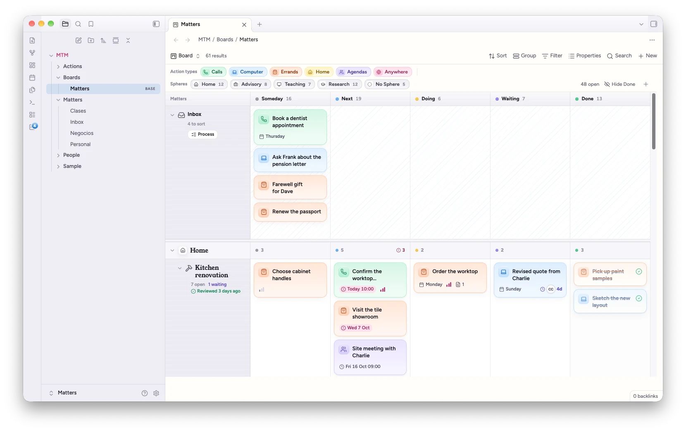
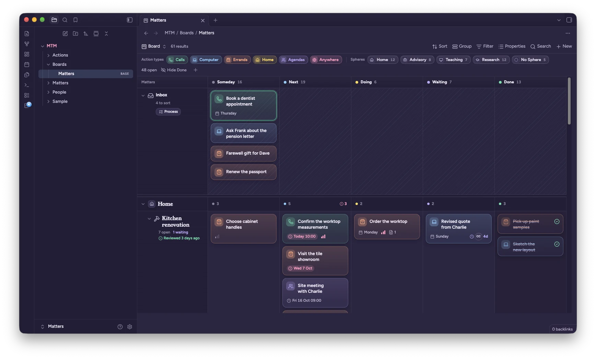
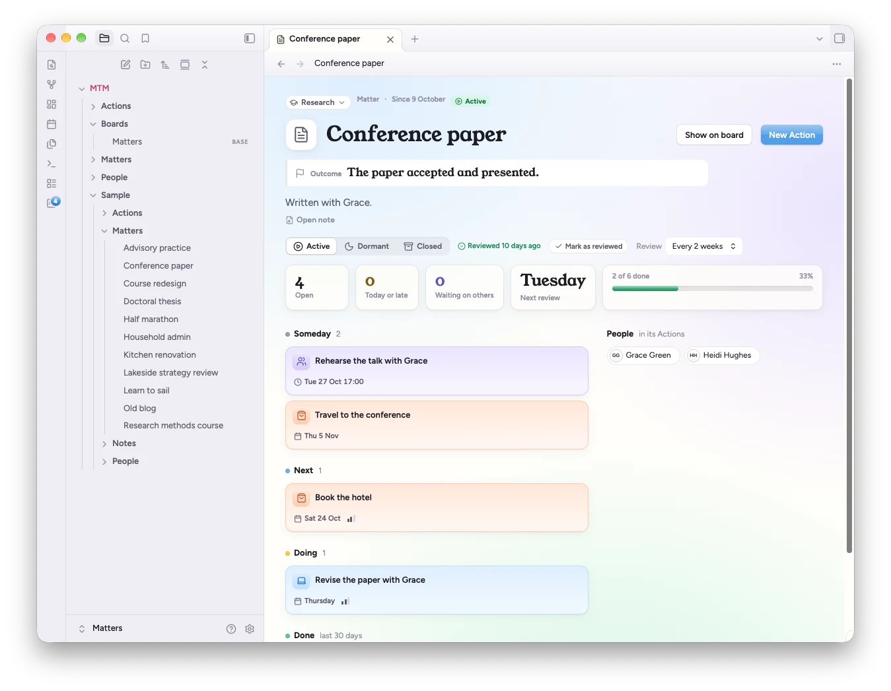

# Calm Matters

A calm, colourful theme for Obsidian: a warm paper page, soft platinum sidebars, pastel accents and a friendly serif for titles. **Dusk**, its dark mode, stays colourful instead of turning grey.

It's made to go with the [Matters that Matter](https://community.obsidian.md/plugins/matters-that-matter) plugin, a board, list, calendar and timeline where every card and every lane is a note, and it works just as well on its own.

## Two modes

**Light** has a warm paper page, soft platinum sidebars and pastel accents.
**Dusk** is the dark mode: deep violet surfaces with lighter pastels.

Switch between them with Obsidian's own setting, under **Settings → Appearance → Base color scheme**.

## What's inside

- **Type:** Figtree for the interface and your notes, Young Serif for titles and headings, JetBrains Mono for code. All three are built into the theme, so nothing loads from the internet.
- **Folders:** top-level folders take turns in sky, bubblegum, mint, butter, lavender and peach.
- **Tags** are soft pastel pills. **Highlights** are butter yellow. **Checked tasks** turn mint.
- **Callouts** each get a pastel of their own.
- **Menus and the command palette** are frosted and rounded, and open with a small spring.
- **Empty tabs** get a calm gradient.

## With Matters that Matter

The plugin brings its own styles and works with any theme. With Calm Matters, its board, inspector, list, calendar, timeline and Matter pages pick up the serif titles, pinstriped headers and calm gradients, quick add turns frosted, and Action notes get the same paper and pastels as the rest of your vault.

To add the plugin: **Settings → Community plugins → Browse**, search for *Matters that Matter*, then **Install** and **Enable**.

## Accent colour

The theme picks a sky blue that suits each mode. For the best result, leave **Settings → Appearance → Accent color** on its default.

## Style Settings

With the [Style Settings](https://github.com/mgmeyers/obsidian-style-settings) plugin you can choose the accent (sky, lavender, mint, bubblegum, peach or butter), turn off the folder colours, use sans-serif headings, hide the welcome message, or remove the gradient behind empty tabs. Everything works without Style Settings too.

## Install

From Obsidian: **Settings → Appearance → Themes → Manage**, search for *Calm Matters*, then **Install and use**.

By hand: copy `theme.css` and `manifest.json` from the latest release into `<your vault>/.obsidian/themes/Calm Matters/`, then choose it under **Settings → Appearance → Themes**.

## Licence

Theme code: MIT, see [LICENSE](LICENSE). Embedded fonts (Figtree, Young Serif, JetBrains Mono): SIL Open Font License 1.1, see [OFL.txt](OFL.txt).
